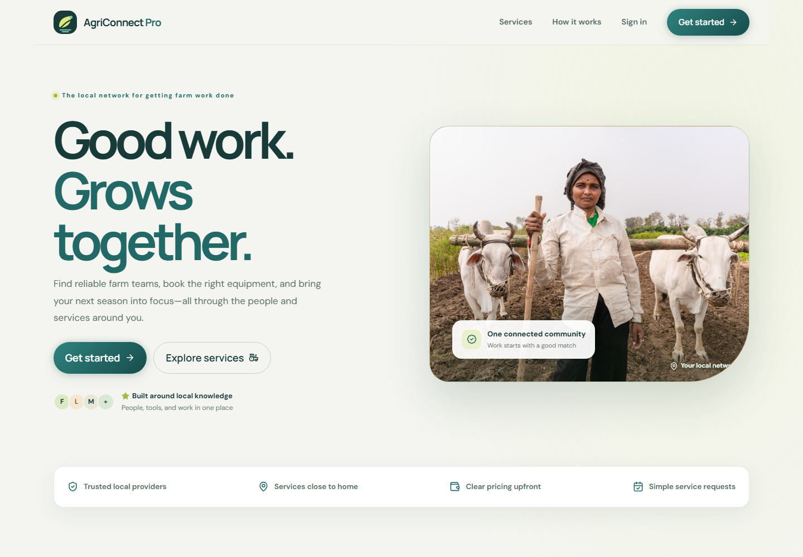
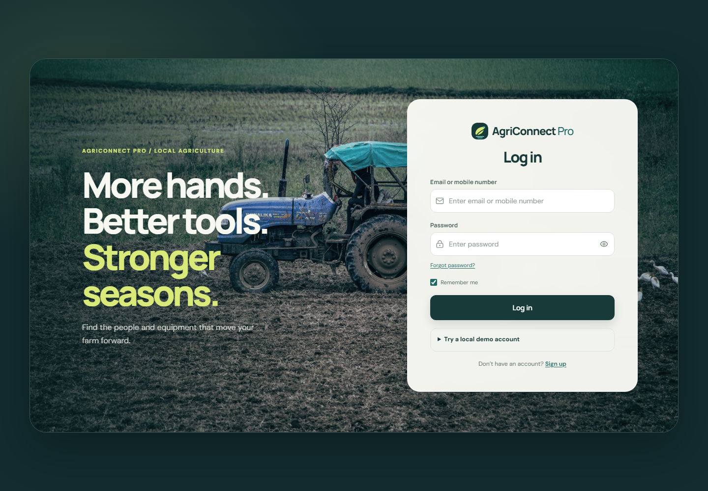
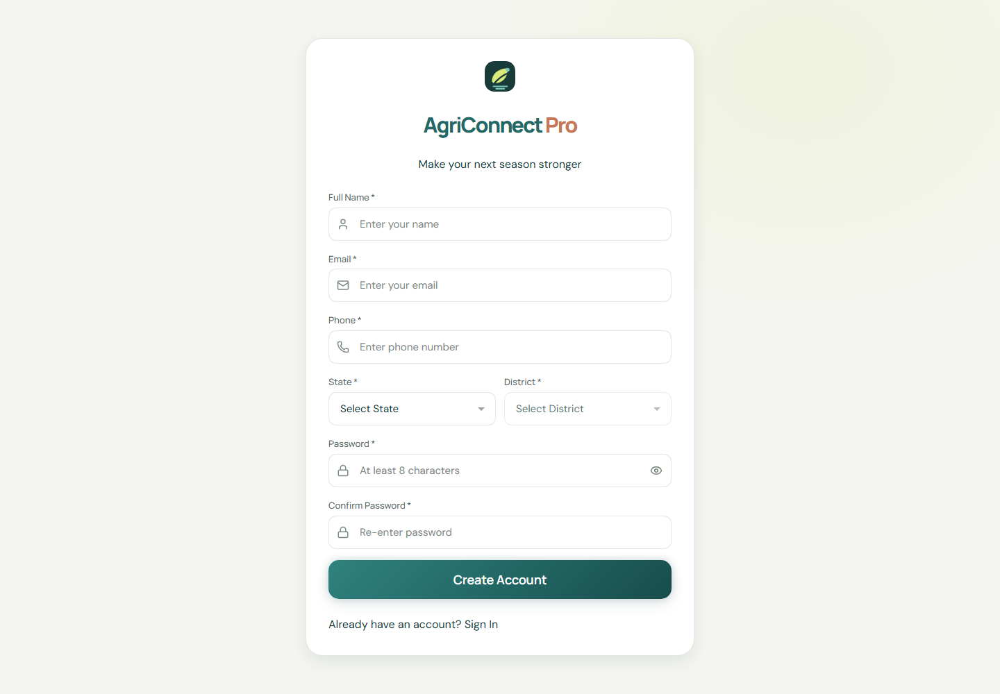
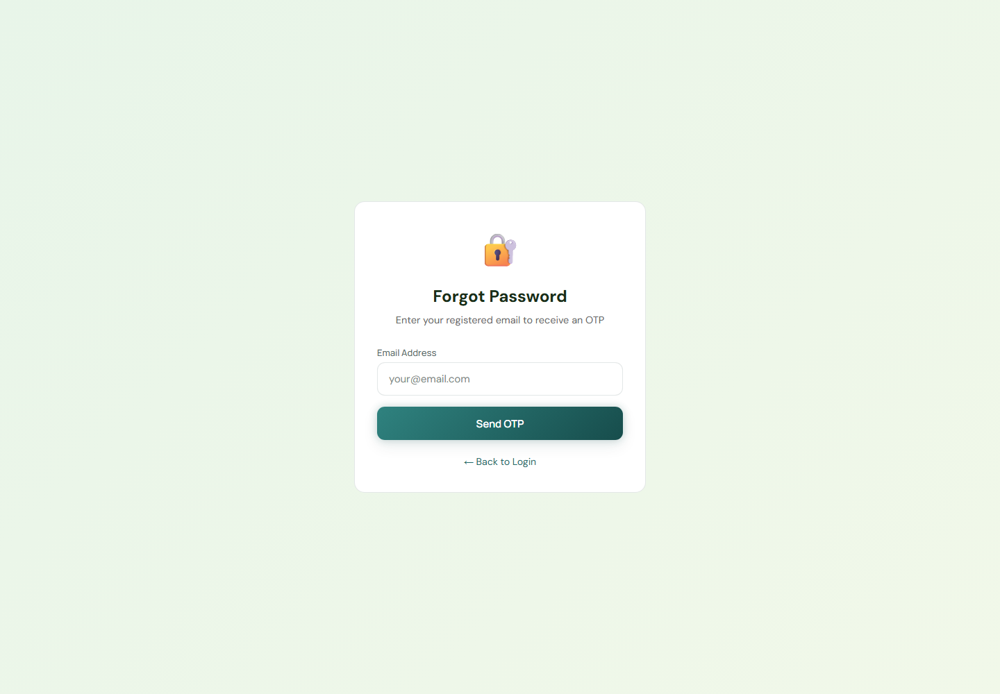

# AgriConnect Pro

AgriConnect Pro is a mobile-friendly farm-services platform for connecting
farmers, labour workers, and farm-equipment owners. It includes job requests,
equipment listings, location-based discovery, and agricultural information
features.

## Production services

- **Web app:** [agri-connect-pro-tan.vercel.app](https://agri-connect-pro-tan.vercel.app/)
- **API health:** [agriconnect-pro.onrender.com/api/health](https://agriconnect-pro.onrender.com/api/health)

The API health endpoint reports the backend and MongoDB connection status.

## Screenshots

These are direct desktop captures of the running application.

<p align="center">
  
  
  <br />
  
  
</p>

## Features

- Account registration, login, password recovery, profiles, and role-based
  access for farmers, labour workers, and machine owners.
- Farm-work requests with acceptance, withdrawal, and request history.
- Equipment listings and a machinery marketplace.
- Nearby discovery and distance calculations using the Haversine formula.
- Plant image upload for disease analysis through Plant.id. Live analysis
  requires a valid `PLANTID_API_KEY`; successful scans are saved per account.
- State- and season-based crop recommendations. These are rule-based
  suggestions, not a substitute for local agricultural advice.
- Weather data through OpenWeather when configured; a sample fallback is used
  when the provider is unavailable or unconfigured.
- Mandi price examples are static sample data, not live market quotes.
- Light and dark themes and multilingual interface support.

## Roles

| Role | Main capabilities |
|---|---|
| Farmer | Post farm-work requests, find services, and manage requests |
| Labour worker | Find nearby work and manage accepted requests |
| Machine owner | Publish equipment listings and respond to service needs |
| Administrator | Reserved for trusted account provisioning; public registration cannot assign this role |

## Technology

| Area | Stack |
|---|---|
| Frontend | React 19, Vite 8, React Router |
| UI | CSS, React Context, Lucide icons |
| Backend | Node.js 22, Express, Mongoose |
| Database | MongoDB |
| Image storage | Cloudinary |
| Hosting | Vercel (frontend), Render (API) |

## Application routes

| Route | Access | Page |
|---|---|---|
| `/` | Public | Landing page |
| `/login` | Public | Sign in |
| `/register` | Public | Account creation |
| `/forgot-password` | Public | Request a password reset |
| `/reset-password` | Public | Reset password |
| `/home` | Signed in | Dashboard |
| `/create-request` | Signed in | Create a farm-work request |
| `/nearby` | Signed in | Nearby requests |
| `/request/:id` | Signed in | Request details |
| `/my-requests` | Signed in | Posted and accepted requests |
| `/profile` | Signed in | Account profile |
| `/machines` | Signed in | Manage equipment listings |
| `/add-machine` | Signed in | Add or edit equipment |
| `/marketplace/machinery` | Signed in | Browse equipment |
| `/recommendations` | Signed in | Equipment recommendations |
| `/disease-detection` | Signed in | Plant image analysis |
| `/crop-recommendation` | Signed in | Crop recommendations |
| `/market-insights` | Signed in | Sample mandi prices and weather |

## Repository structure

```text
Agriconnect/
├── backend/
│   ├── config/
│   │   ├── cloudinary.js
│   │   └── db.js
│   ├── controllers/
│   │   ├── authController.js
│   │   ├── cropController.js
│   │   ├── diseaseController.js
│   │   ├── machineController.js
│   │   ├── marketController.js
│   │   ├── ratingController.js
│   │   ├── recommendationController.js
│   │   ├── requestController.js
│   │   └── userController.js
│   ├── middleware/
│   │   ├── auth.js
│   │   ├── errorHandler.js
│   │   └── upload.js
│   ├── models/
│   │   ├── DiseaseScan.js
│   │   ├── Machine.js
│   │   ├── Request.js
│   │   └── User.js
│   ├── routes/
│   │   ├── authRoutes.js
│   │   ├── cropRoutes.js
│   │   ├── diseaseRoutes.js
│   │   ├── machineRoutes.js
│   │   ├── marketRoutes.js
│   │   ├── ratingRoutes.js
│   │   ├── recommendationRoutes.js
│   │   ├── requestRoutes.js
│   │   └── userRoutes.js
│   ├── services/
│   │   ├── emailService.js
│   │   ├── fcfsService.js
│   │   ├── haversineService.js
│   │   ├── knnRecommendationService.js
│   │   └── weatherService.js
│   ├── test/
│   │   ├── accountData.integration.test.js
│   │   ├── changePassword.integration.test.js
│   │   ├── demoPasswordReset.test.js
│   │   ├── generateOTP.test.js
│   │   └── roleAccess.integration.test.js
│   ├── utils/
│   │   ├── constants.js
│   │   ├── demoPasswordReset.js
│   │   ├── generateOTP.js
│   │   └── generateToken.js
│   ├── .gitignore
│   ├── package.json
│   ├── package-lock.json
│   └── server.js
├── public/
│   ├── images/
│   │   ├── farmer-with-oxen-india.jpg
│   │   └── tractor-plowing-india.jpg
│   ├── favicon.svg              # Active app mark and browser icon
│   ├── icons.svg                # Present but not currently referenced by the app
│   └── logo.png                 # Alternate artwork; not currently referenced by the app
├── src/
│   ├── components/
│   │   ├── BottomNav.css
│   │   ├── BottomNav.jsx
│   │   ├── BrandMark.jsx
│   │   ├── ErrorMessage.jsx
│   │   ├── Header.css
│   │   ├── Header.jsx
│   │   ├── Layout.css
│   │   ├── Layout.jsx
│   │   ├── Modal.css
│   │   ├── Modal.jsx
│   │   ├── PasswordInput.jsx
│   │   ├── RatingStars.css
│   │   ├── RatingStars.jsx
│   │   ├── RequestCard.css
│   │   ├── RequestCard.jsx
│   │   ├── Sidebar.css
│   │   ├── Sidebar.jsx
│   │   ├── Spinner.jsx
│   │   ├── StatusBadge.css
│   │   ├── StatusBadge.jsx
│   │   ├── Toast.css
│   │   ├── Toast.jsx
│   │   ├── WeatherWidget.css
│   │   └── WeatherWidget.jsx
│   ├── constants/
│   │   └── categories.js
│   ├── context/
│   │   ├── AppContext.jsx
│   │   ├── AuthContext.jsx
│   │   ├── LanguageContext.jsx
│   │   ├── ThemeContext.js
│   │   ├── ThemeProvider.jsx
│   │   ├── authState.js
│   │   └── useAuth.js
│   ├── data/
│   │   ├── categories.js
│   │   ├── intelligence.js
│   │   ├── languages.js
│   │   ├── mockRequests.js
│   │   └── mockUsers.js
│   ├── hooks/
│   │   ├── useNearby.js
│   │   ├── useRequests.js
│   │   ├── useTheme.js
│   │   └── useWeather.js
│   ├── pages/
│   │   ├── AddMachine.css
│   │   ├── AddMachine.jsx
│   │   ├── CreateRequest.css
│   │   ├── CreateRequest.jsx
│   │   ├── CropRecommendation.css
│   │   ├── CropRecommendation.jsx
│   │   ├── DiseaseDetection.css
│   │   ├── DiseaseDetection.jsx
│   │   ├── ForgotPassword.css
│   │   ├── ForgotPassword.jsx
│   │   ├── Home.css
│   │   ├── Home.jsx
│   │   ├── Landing.css
│   │   ├── Landing.jsx
│   │   ├── Login.css
│   │   ├── Login.jsx
│   │   ├── MachineryMarketplace.css
│   │   ├── MachineryMarketplace.jsx
│   │   ├── Machines.css
│   │   ├── Machines.jsx
│   │   ├── MarketInsights.css
│   │   ├── MarketInsights.jsx
│   │   ├── MyRequests.css
│   │   ├── MyRequests.jsx
│   │   ├── NearbyRequests.css
│   │   ├── NearbyRequests.jsx
│   │   ├── Profile.css
│   │   ├── Profile.jsx
│   │   ├── Recommendations.css
│   │   ├── Recommendations.jsx
│   │   ├── Register.css
│   │   ├── Register.jsx
│   │   ├── RequestDetail.css
│   │   ├── RequestDetail.jsx
│   │   ├── ResetPassword.css
│   │   ├── ResetPassword.jsx
│   │   ├── RoleSelection.css
│   │   ├── RoleSelection.jsx
│   │   ├── Splash.css
│   │   └── Splash.jsx
│   ├── services/
│   │   ├── api.js
│   │   ├── authService.js
│   │   ├── cropService.js
│   │   ├── diseaseService.js
│   │   ├── machineService.js
│   │   ├── marketService.js
│   │   ├── ratingService.js
│   │   ├── recommendationService.js
│   │   ├── requestService.js
│   │   └── userService.js
│   ├── utils/
│   │   ├── distance.js
│   │   ├── fcfs.js
│   │   ├── helpers.js
│   │   ├── location.js
│   │   └── storage.js
│   ├── App.jsx
│   ├── connect-pro.css
│   ├── index.css
│   └── main.jsx
├── .gitignore
├── DEPLOYMENT.md
├── eslint.config.js
├── index.html
├── package.json
├── package-lock.json
├── README.md
├── render.yaml
├── vercel.json
└── vite.config.js
```

Generated files and private local data are intentionally excluded from this
tree. `node_modules/`, frontend `dist/`, local MongoDB data, and `.env` files
should not be committed. The local backend configuration belongs in the
Git-ignored `backend/.env` file.

## Local development

### Requirements

- Node.js 22.x and npm
- A browser
- MongoDB Atlas credentials only if you want to use a remote database locally;
  without `MONGODB_URI`, the backend starts its persistent local development
  database

### Start the frontend

From the repository root:

```powershell
npm ci
npm run dev
```

Open `http://localhost:5173`. The default API address is
`http://localhost:5000/api`. To use another API, set `VITE_API_URL` in the
Git-ignored root `.env.local` file and restart Vite.

### Start the backend

In a second terminal:

```powershell
Set-Location backend
npm ci
npm run dev
```

Configure local backend settings in `backend/.env`. Keep secrets out of source
control. For local API access from another frontend origin, set
`CLIENT_URL=http://localhost:5173`. The backend health check is
`http://localhost:5000/api/health`.

Image uploads use Cloudinary. Set `CLOUDINARY_CLOUD_NAME`,
`CLOUDINARY_API_KEY`, and `CLOUDINARY_API_SECRET` in the backend environment
to enable profile and equipment image storage. Plant image analysis also
requires `PLANTID_API_KEY`; weather uses `OPENWEATHER_API_KEY`. See
[DEPLOYMENT.md](./DEPLOYMENT.md) for the full environment-variable reference.

### Local demo accounts

Demo accounts are seeded only when the backend is not running in production.
The development login screen can fill in these accounts:

| Role | Email |
|---|---|
| Farmer | `farmer@connectpro.demo` |
| Labour worker | `labour@connectpro.demo` |
| Machine owner | `machine@connectpro.demo` |
| Administrator | `admin@connectpro.demo` |

**Local demo password:** `ConnectProDemo!2026`

These are development-only credentials. Production does not seed demo users;
do not use these credentials for a deployed account.

## Validation

Run commands from the repository root unless noted:

```powershell
npm run build
npm run lint
```

Run backend tests from `backend/`:

```powershell
npm test
```

## Image credits

- Login image, “Tractor plowing the field” by [Rahul Mahalik on Pexels](https://www.pexels.com/photo/tractor-plowing-the-field-18135422/).
- Landing image, “Farmers in India” by [EqualStock IN on Pexels](https://www.pexels.com/photo/farmers-in-india-20515274/).
- Both photographs are used under the [Pexels License](https://www.pexels.com/license/).

## Important limitations

- Market prices shown in the app are sample values and should not be used for
  trading decisions.
- Crop recommendations are rule-based and informational.
- Disease analysis depends on the configured external provider and should not
  replace advice from a qualified agricultural expert.
- Local demo accounts and local MongoDB fallback are for development only.
